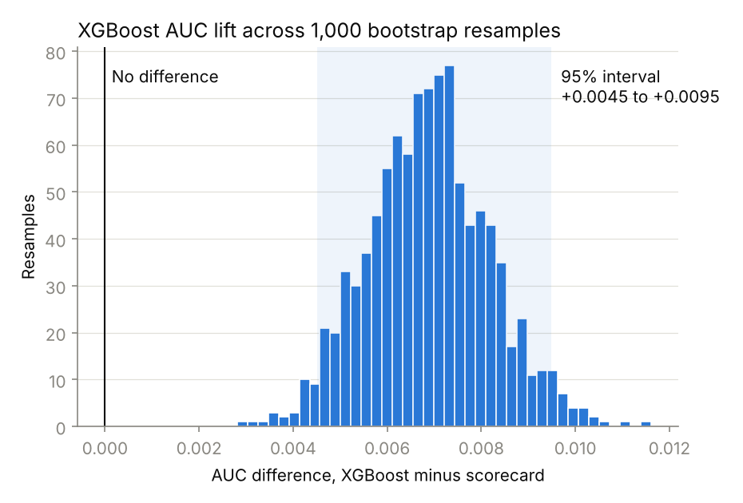
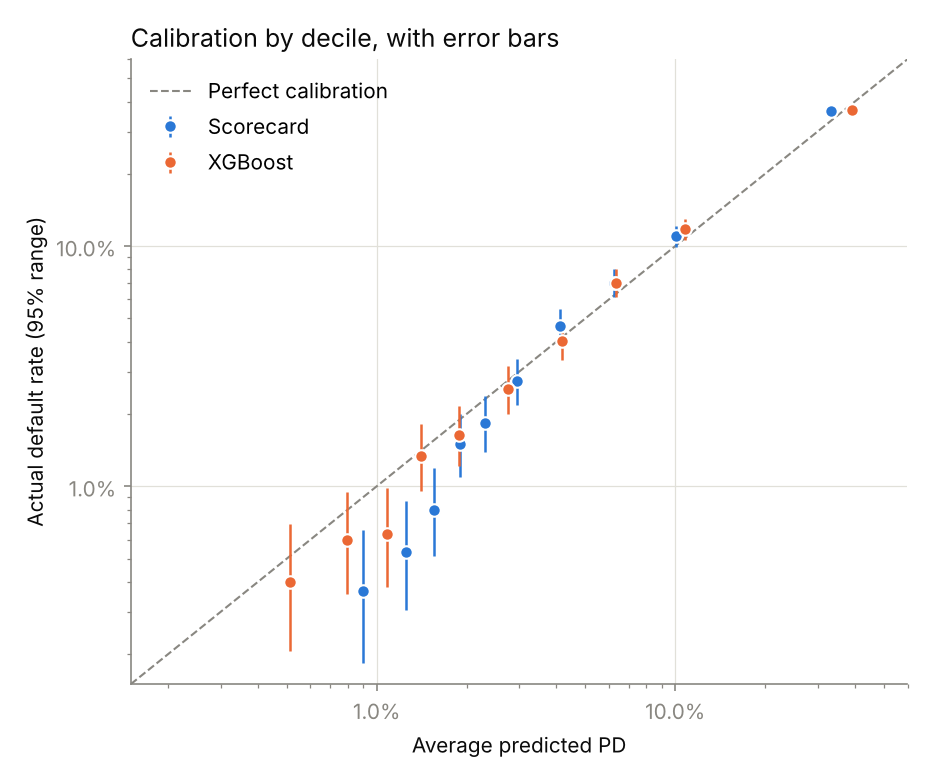
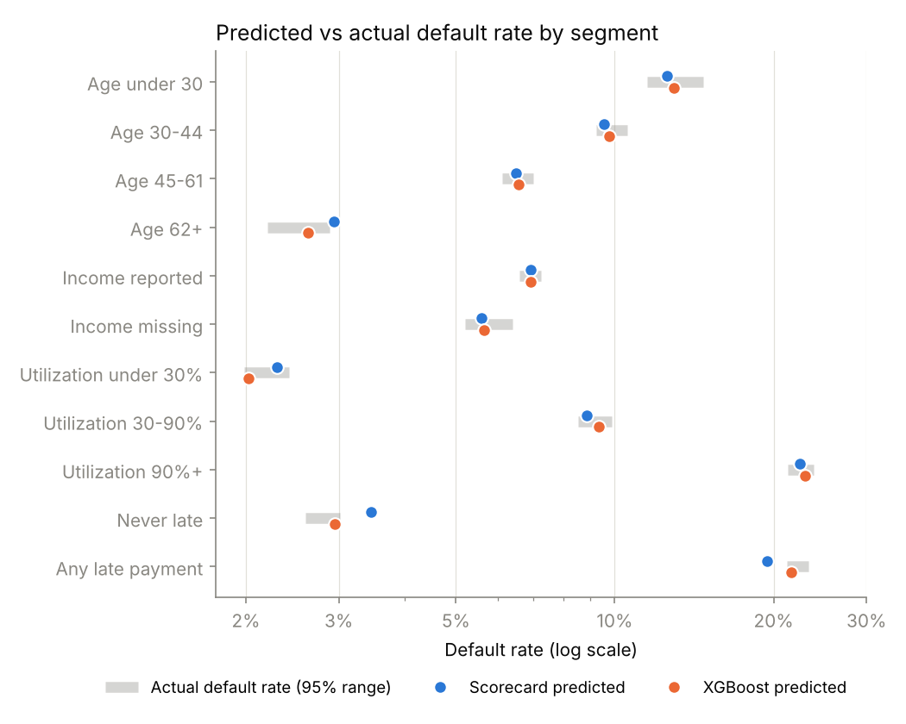
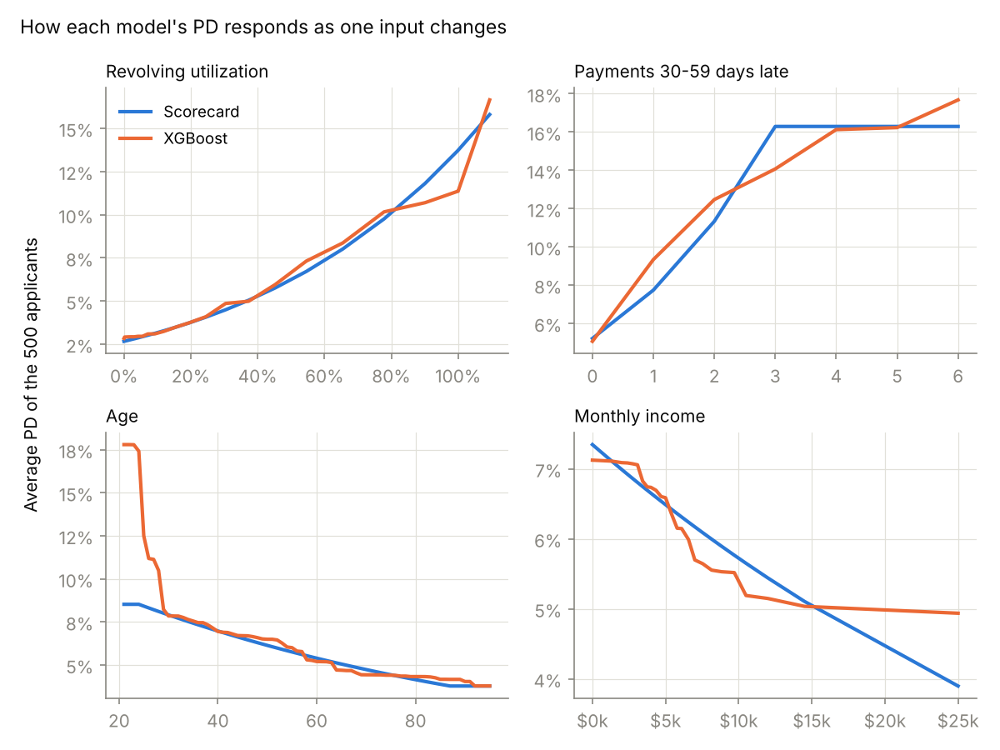
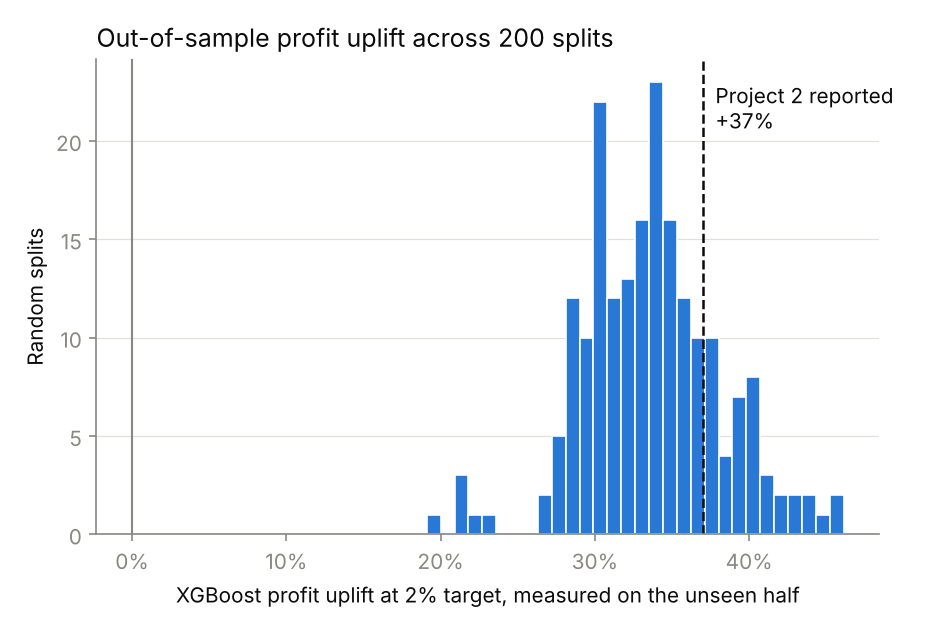

# Credit Model Validation — Scorecard and XGBoost

A model validation review of two credit risk models, structured the way a bank's model risk management team or a consulting firm would review them before approving their use:

- **Scorecard:** the interpretable logistic regression from [credit-risk-scorecard](https://github.com/pooja003-cloud/credit-risk-scorecard) (project 1)
- **XGBoost:** the monotone-constrained challenger from [credit-lending-strategy](https://github.com/pooja003-cloud/credit-lending-strategy) (project 2)

Six checks cover replication, the statistical significance of the XGBoost lift, calibration, stability and segments, sensitivity, and an out-of-sample challenge of project 2's business conclusions. They use the same 30,000 hold-out borrowers as both projects plus 101,503 new applicants.

**Result:** 21 detailed findings: 14 Pass, 7 Monitor, 0 Fail. Both models are fit for use with conditions. The review confirmed that XGBoost approves more applicants at the same default rate, made three corrections to the earlier projects (listed under *Corrections*), and found that **most of project 2's headline profit uplift depends on a revenue assumption** rather than on the model alone.

## Overall opinion

| Model | Opinion | Conditions |
|---|---|---|
| **Scorecard** | Fit for use, with conditions | Its probabilities are systematically off: too high for the safest borrowers and for borrowers who have never been late, too low for the riskiest decile and for borrowers with late payments. Recalibrate before using its PDs for pricing or loss estimates. Refer the age 62+ overstatement for fair-lending review. |
| **XGBoost** | Fit for use, with conditions | Better ranking (statistically significant) and better calibration. Before relying on its reason codes, add monotone constraints to the three inputs that still zigzag. |

**Which one to use depends on the lending strategy.** For a selective lender (a 2% target default rate), XGBoost approved **2,907 more applicants per 100,000** on unseen borrowers, ahead in every one of 200 tests: about 4.7% more approvals at the same default rate. Its profit advantage is **between about +5% and +37%**, depending on how much approved borrowers actually borrow (check 6d). For a lender approving nearly everyone, it offers no advantage, and the simpler scorecard is just as profitable.

## Findings

| # | Check | Finding | Rating |
|---|---|---|---|
| 1 | Replication | Both saved models reproduce their reported AUC (scorecard 0.8607, XGBoost 0.8676) | Pass |
| 2 | Data integrity | 174 test borrowers (0.58%) have an identical twin in the training data; removing them changes AUC by at most 0.0003 | Pass |
| 3 | XGBoost lift | +0.0069 AUC, 95% interval +0.0045 to +0.0095; XGBoost wins all 1,000 bootstrap resamples | Pass |
| 4 | Scorecard calibration | 5 of 10 deciles outside their 95% range: deciles 1, 2, 3 and 5 overstate risk; **the riskiest decile understates it** (34.26% predicted vs a 34.68–38.15% range) | Monitor |
| 5 | XGBoost calibration | 2 of 10 deciles outside their range (3 overstates; 9 understates, 10.43% vs 10.60–12.94%), close to what chance alone produces | Monitor |
| 6 | Stability | Every feature and score PSI below 0.001 on new applicants (a weak test here: see Limitations) | Pass |
| 7 | Segments | XGBoost is within range in all 11 segments. The scorecard is off in 3: never late (overstates), any late payment (understates), age 62+ (overstates; refer for fair-lending review) | Monitor (scorecard) / Pass (XGBoost) |
| 8 | Sensitivity, constrained inputs | Zero wrong-direction moves across 500 applicants for both models; no applicant is ever scored riskier at age 62+. This confirms the designed constraints are present in the saved models | Pass |
| 9 | Sensitivity, unconstrained inputs | XGBoost's open credit lines, real estate loans and dependents move risk in both directions for 447–500 of 500 applicants, zigzagging in sparse values | Monitor |
| 10 | Project 2: 2% target claim | Out of sample: **+2,907 extra approvals per 100,000** (reported +3,477); profit **+33.6%** (5th–95th percentile +27.7% to +41.5%) under project 2's revenue assumption (reported +37%) | Pass |
| 11 | Project 2: profit-maximizing cut-off | Reported +0.1%; **−0.4%** with borrower-level precision; out of sample median −0.8% (−2.1% to +0.6%), XGBoost ahead in only 14% of splits | Monitor |
| 12 | Cut-off at exactly 2% | On unseen borrowers the default rate exceeds 2% in 50% (scorecard) and 42% (XGBoost) of splits | Monitor |
| 13 | Assumption stress | Under 9 APR / loss-rate scenarios, XGBoost wins at the 2% target in all of them (+34% to +45%); at the profit-maximizing cut-off the difference stays between −0.4% and +4.5% | Pass |
| 14 | Drawn-balance assumption | At the 2% target, profit uplift is **+37.2%** when each borrower draws their own utilization, but **+4.7%** when everyone draws a flat 30%, 50% or 70%. The robust part is the volume effect (+4.7% approvals); the other +32.4 points hold only if current utilization predicts future balances | Monitor |

All 21 detailed findings are in [`outputs/findings.csv`](outputs/findings.csv).

## Recommendations

1. **Set cut-offs with a buffer.** A cut-off tuned to exactly the target default rate misses it about half the time on new borrowers. Choose the cut-off so that the default rate stays under the target in, say, 95% of out-of-sample tests, not on average. *(Finding 12)*
2. **Constrain XGBoost's remaining inputs.** Add monotone constraints for real estate loans and dependents, cap open credit lines at a sensible maximum, and re-check the AUC cost before any reason code relies on them. *(Finding 9)*
3. **Recalibrate the scorecard if it stays in use.** Its errors follow a pattern (it under-weights payment history and over-predicts the safest borrowers), so an isotonic or Platt recalibration, or WoE binning, should be applied before its PDs drive pricing or expected loss. *(Findings 4, 7)*
4. **Fair-lending review.** Refer the scorecard's overstatement for the age 62+ group, and run disparate-impact testing on both models across protected groups. *(Finding 7)*
5. **Lead with approvals, report profit as a range.** The claim that holds under any revenue assumption is "about 4.7% more approvals at the same default rate (+2,907 per 100,000 out of sample)". Present profit as "+5% to +37%, depending on how much approved borrowers draw", and test whether current utilization predicts future balances before relying on the upper end. *(Findings 10, 14)*
6. **Correct project 2's reported figures.** At the profit-maximizing cut-off, report "no advantage (−0.4%)" instead of "+0.1%". *(Finding 11)*
7. **Get out-of-time data for monitoring.** Track PSI on applicants from later periods, with alert thresholds of 0.10 and 0.25, and keep watching XGBoost's decile 9. *(Findings 5, 6)*

## Corrections to the earlier projects

This review challenged my own earlier work, and three results changed:

| Earlier claim | What this review found |
|---|---|
| Project 2: XGBoost +0.1% profit at the profit-maximizing cut-off | **−0.4%.** Project 2 searched cut-offs in 1% steps of approval rate; the scorecard's true peak ($45.76M at 92.43% approval) falls between two steps, so its best profit was under-measured ($45.49M). |
| Project 2: +37% profit at a 2% target default rate | **+33.6% out of sample** (+27.7% to +41.5%), measured on data not used to choose the cut-off. More importantly, **about seven-eighths of it depends on the revenue assumption**: with a flat drawn balance, the uplift is +4.7%, which is simply the extra approvals. |
| Project 1: the riskiest deciles are "within 6–9%" of actual | True in size, but **the riskiest decile's understatement is statistically significant**, and it's in the dangerous direction (under-estimating risk for the riskiest borrowers). |

## Evidence

### Check 1 — Replication and data integrity

Both models were reloaded from their saved files and re-scored on the same 30,000 hold-out borrowers. They reproduce their reported AUCs exactly (to three decimals).

The data contains 960 rows (0.64%) that are exact copies of another row, in 344 groups; in 7 groups, identical borrowers had different outcomes. 174 test borrowers (0.58%) have an identical twin in the training data, so both models had effectively seen them. Removing them changes AUC by −0.0002 (scorecard) and −0.0003 (XGBoost): the earlier results are not inflated by leakage.

### Check 2 — Is the XGBoost lift real?

A paired bootstrap: 1,000 resamples of the 30,000 test borrowers, scoring both models on the same resampled borrowers each time.

| | AUC | 95% interval |
|---|---|---|
| Scorecard | 0.8607 | 0.8523 – 0.8695 |
| XGBoost | 0.8676 | 0.8596 – 0.8761 |
| **Difference** | **+0.0069** | **+0.0045 to +0.0095** |

<p align="center"></p>

The two models' individual intervals overlap, which might suggest no real difference. But both models are scored on the same borrowers, so when a resample is easier or harder, both move together. The paired difference never reaches zero: the lift is small but genuine.

### Check 3 — Calibration with error bars

Each decile's predicted PD is compared with an exact 95% binomial range for the true default rate, given the defaults observed. Only gaps too large to be chance are flagged.

<p align="center"></p>

| Decile | Defaults | Actual | 95% range | Scorecard predicted | Verdict |
|---|---|---|---|---|---|
| 1 | 11 | 0.37% | 0.18% – 0.66% | 0.93% | Overstates |
| 2 | 16 | 0.53% | 0.31% – 0.86% | 1.29% | Overstates |
| 3 | 24 | 0.80% | 0.51% – 1.19% | 1.61% | Overstates |
| 5 | 55 | 1.83% | 1.38% – 2.38% | 2.38% | Overstates |
| 10 | 1092 | 36.40% | 34.68% – 38.15% | 34.26% | **Understates** |

The scorecard's errors are **systematic**: it over-predicts the safe end and under-predicts the riskiest decile. XGBoost has two flags (decile 3 slightly over, decile 9 under). Ten tests at 95% confidence produce about half a flag by chance, so two is only mildly unusual; decile 9 is still worth watching because it understates risk.

### Check 4 — Stability and segments

**Drift.** The Population Stability Index compares each feature's distribution in the training data with the 101,503 new applicants in Kaggle's `cs-test.csv`. Every feature and both models' scores have PSI below 0.001 (the largest is monthly income at 0.0004), far below the 0.10 warning level. Both models' average PD on new applicants is 6.70%, against 6.68% in training.

**Segments.** Predicted vs actual default rate, with the actual rate's 95% range, for groups a validator would check:

<p align="center"></p>

| Segment | Borrowers | Actual (95% range) | Scorecard | XGBoost |
|---|---|---|---|---|
| Never late | 24,000 | 2.80% (2.59% – 3.01%) | **3.46%** | 2.95% |
| Any late payment | 6,000 | 22.23% (21.19% – 23.31%) | **19.44%** | 21.60% |
| Age 62+ | 8,312 | 2.53% (2.20% – 2.89%) | **2.93%** | 2.62% |

The scorecard **under-weights payment history**: too harsh on borrowers who have never been late, too lenient on those who have. This is the same pattern project 2's swap set showed. XGBoost is within range in all 11 segments (full table in `outputs/segments.csv`).

The age 62+ result needs careful reading. The scorecard's age weight only ever lowers risk, so it doesn't break the Reg B rule against penalizing applicants 62 or older for their age (check 5 confirms this). The overstatement comes from how the other factors add up for this group. But a model that systematically overstates risk for a protected age group is exactly what a fair-lending review should examine.

### Check 5 — Sensitivity

For 500 test applicants, each input was moved across its full range while everything else was held fixed, and the PD was checked for any move in the wrong direction.

| Input | Should | Scorecard violations | XGBoost violations |
|---|---|---|---|
| Revolving utilization | Raise risk | 0 / 500 | 0 / 500 |
| Payments 30–59, 60–89 and 90+ days late | Raise risk | 0 / 500 each | 0 / 500 each |
| Debt ratio | Raise risk | not used | 0 / 500 |
| Age | Lower risk | 0 / 500 | 0 / 500 |
| Monthly income | Lower risk | 0 / 393 | 0 / 393 |

No applicant was ever scored riskier at any age from 62 to 95 than at a younger age, under either model.

Both models are built to pass this check: the scorecard has one weight per input, and XGBoost has monotone constraints on these inputs. So the check **confirms that the saved models contain the designed constraints**; it doesn't independently prove good behaviour. The income sweep uses only the 393 sampled applicants who reported an income, since setting an income for someone flagged "income missing" would create impossible rows.

<p align="center"></p>

The curves show where the models differ. XGBoost puts much more weight on youth: set to age 21, the 500 applicants average a 17.79% PD under XGBoost versus 8.52% under the scorecard, so "age" will appear as a decline reason more often for young applicants. For income, the scorecard keeps lowering risk in a straight line (7.35% → 3.90% from the lowest to the highest income tested), while XGBoost levels off (7.12% → 4.94%).

**The three inputs XGBoost was not constrained on** behave less smoothly (average PD of the 500 applicants):

| Real estate loans | 0 | 1 | 2 | 3 | 4 | 5 | 6 |
|---|---|---|---|---|---|---|---|
| XGBoost | 6.35% | 5.62% | 6.03% | 7.41% | 8.95% | **12.60%** | **9.53%** |
| Scorecard | 5.85% | 6.33% | 6.84% | 7.39% | 7.98% | 7.98% | 7.98% |

Open credit lines are U-shaped (zero lines is riskier than 3–6, a plausible "thin file" effect) but zigzag above 20 lines. Dependents mostly rise, with small wiggles. A reason code built on "6 real estate loans is safer than 5" could not be defended to a customer.

### Check 6 — Challenging project 2's conclusions

**Out-of-sample cut-offs.** Project 2 chose cut-offs and measured profit on the same borrowers. Here the cut-off is chosen on a random half of the test set and applied to the other half, repeated over 200 random splits (median, with 5th–95th percentile):

| At a 2% target default rate | Scorecard | XGBoost |
|---|---|---|
| Approval rate | 73.69% (71.20% – 75.96%) | 76.85% (74.52% – 78.60%) |
| Default rate on the unseen half | 2.00% (1.71% – 2.24%) | 1.98% (1.72% – 2.21%) |
| Profit per 100,000 applicants | $23.64M ($21.45M – $25.74M) | $31.95M ($29.52M – $33.22M) |

<p align="center"></p>

XGBoost approves 2,907 more applicants per 100,000 (+1,810 to +4,408), and its profit uplift under project 2's revenue assumption is +33.6% (+27.7% to +41.5%), ahead in all 200 splits. At the profit-maximizing cut-off, by contrast, XGBoost is ahead in only 14% of splits (median −0.8%).

**Assumption stress test.** XGBoost's profit uplift over the scorecard under nine combinations of APR and loss rate (full test set):

| APR | LGD | At 2% target | At best cut-off |
|---|---|---|---|
| 15% | 60% | +38.6% | +0.6% |
| 15% | 80% | +42.5% | +2.4% |
| 15% | 90% | +44.9% | +4.5% |
| 20% | 60% | +35.3% | +0.4% |
| 20% | 80% | +37.2% | −0.4% |
| 20% | 90% | +38.2% | +0.3% |
| 25% | 60% | +34.0% | +0.4% |
| 25% | 80% | +35.2% | +0.4% |
| 25% | 90% | +35.9% | +0.1% |

The 2% target conclusion holds in every scenario. At the profit-maximizing cut-off, **XGBoost's advantage grows as margins tighten** (+4.5% at 15% APR and 90% LGD), which confirms the prediction in project 2's Limitations: thinner margins push lenders to be more selective, which is where XGBoost helps.

**Drawn-balance assumption (6d).** APR and loss rate turn out not to be the inputs that drive the result. Project 2 assumed each approved borrower draws their current utilization of a $10,000 limit, so interest revenue rises with utilization, and XGBoost approves heavier credit users. Re-pricing the same cut-offs with everyone drawing a flat share of their limit:

| Drawn balance | Approved at 2% (scorecard / XGBoost) | Average utilization of approved | Uplift at 2% target | Uplift at best cut-off |
|---|---|---|---|---|
| Own utilization (project 2) | 22,074 / 23,117 | 15.4% / 19.3% | **+37.2%** | −0.4% |
| Flat 30% | 22,074 / 23,117 | 15.4% / 19.3% | +4.7% | +1.1% |
| Flat 50% | 22,074 / 23,117 | 15.4% / 19.3% | +4.7% | +0.3% |
| Flat 70% | 22,074 / 23,117 | 15.4% / 19.3% | +4.7% | +0.0% |

The uplift splits into two parts:
- **Volume effect, +4.7%:** XGBoost approves more applicants at the same default rate. This holds under any revenue assumption.
- **Balance-mix effect, +32.4 points:** XGBoost approves borrowers who carry larger balances. This is something the model genuinely does, but it is only worth money if today's utilization predicts future balances, which this dataset can't show.

Revenue scaling with balances is realistic for credit cards, so project 2's assumption is defensible; it just needs to be stated as the main driver of the profit figure, not hidden among other assumptions.

## Limitations of this validation

- **This is a self-review, not an independent validation.** I built both models. A real model risk function is organizationally separate from the developers; this review follows their method, and deliberately challenges my own earlier claims, but it can't provide that independence.
- **The drift test is weak here.** Kaggle appears to have split its data at random, so the "new applicants" are the same population and near-zero PSI is expected. A meaningful drift test needs applicants from a later time period.
- **No reject inference.** The dataset only contains borrowers who received credit, so neither model can be tested on applicants a lender actually declined.
- **Business assumptions are illustrative.** Profit figures depend on the assumed credit limit, APR, cost of funds, loss rates and, above all, the drawn balance (check 6d); the stress tests cover a range, not every possibility.
- **No fair-lending testing.** The review flags the age 62+ result but does not test disparate impact across protected groups, which the dataset can't support beyond age.
- **Multiple comparisons.** With many tests at 95% confidence, a few flags are expected by chance. Ratings consider patterns (for example, the scorecard's systematic decile errors), not single flags.

## Method

1. **Replication** — reload both saved models, re-score the hold-out set, compare with reported AUC; find exact duplicates and train/test twins.
2. **Lift** — paired bootstrap, 1,000 resamples, 95% percentile intervals.
3. **Calibration** — exact (Clopper–Pearson) 95% binomial interval for each decile's default rate.
4. **Stability** — PSI with 10 bins from the training data (missing values as their own bin), training vs test (control) and training vs `cs-test.csv`; calibration and AUC for 11 segments.
5. **Sensitivity** — 500 applicants (excluding data-entry codes; the income sweep also excludes applicants with no reported income); each input swept across its range with others fixed; checks for wrong-direction moves and the age 62+ rule.
6. **Project 2 challenge** — cut-off search at borrower level; cut-offs chosen on one half and applied to the other over 200 stratified splits; a 3 × 3 grid of APR and LGD; flat drawn-balance scenarios of 30%, 50% and 70%.

Both models use the same cleaning and the same stratified 80/20 split (`random_state=42`) as projects 1 and 2.

## Project structure

```
credit-model-validation/
├── validate.py              # all six checks, in order
├── requirements.txt         # pinned versions
├── models/                  # the two models under review, used as-is
│   ├── scorecard/           # project 1 (commit aa5508d): scorecard.py + outputs/scorecard_model.pkl
│   └── xgboost/             # project 2 (commit 02750de): xgboost_model.json
├── data/                    # credit_data.csv and cs-test.csv (not tracked)
└── outputs/
    ├── findings.csv          # all 21 detailed findings and ratings
    ├── auc_lift_bootstrap.png
    ├── calibration_error_bars.png
    ├── segment_calibration.png
    ├── sensitivity.png
    ├── out_of_sample_uplift.png
    ├── psi.csv, segments.csv, assumption_stress.csv, drawn_balance_scenarios.csv
    └── run_output.txt        # full console output of the latest run
```

## How to run

1. From the [Give Me Some Credit competition](https://www.kaggle.com/c/GiveMeSomeCredit/data) (free Kaggle account required), download `cs-training.csv` and `cs-test.csv`.
2. Save them as `data/credit_data.csv` and `data/cs-test.csv`.
3. Install and run (Python 3.11 or newer; takes about a minute):

```bash
python3 -m venv .venv && source .venv/bin/activate
pip install -r requirements.txt
python validate.py
```

The datasets are not included in this repository, in line with Kaggle's competition rules.

## Data

[Give Me Some Credit](https://www.kaggle.com/c/GiveMeSomeCredit) (Kaggle, 2011): 150,000 borrowers with outcomes (`cs-training.csv`) and 101,503 applicants without outcomes (`cs-test.csv`); 10 numeric features; target `SeriousDlqin2yrs` (90+ days past due within two years).
